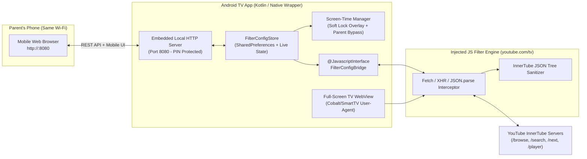

# YouTube Mix — Android TV Child-Safe YouTube Client
## Research & Technical Architecture Document

---

## 1. Executive Summary & Goal
**YouTube Mix** is a custom Android TV application designed for personal/family use. It provides the exact same experience as the official Android TV YouTube app (including **Google Sign-In**, **YouTube Premium ad-free playback**, **4K streaming**, and **D-pad remote navigation**), while adding a **Parent-Controlled Content Filtering Layer** that intercepts and scrubs recommendations, search results, and "Up Next" queues before they ever appear on the TV screen.

---

## 2. Why Option B (`youtube.com/tv` Wrapper + JS Interceptor) Wins
The official YouTube app on Android TV, Apple TV, PlayStation, Samsung Tizen, and LG webOS is actually a web application hosted at `https://www.youtube.com/tv` running inside a TV-optimized browser container (Google Cobalt or Android System WebView).

By wrapping `https://www.youtube.com/tv` in an Android TV app with an injected JavaScript + Native Bridge interceptor:
1. **Zero API Quotas:** Doesn't rely on the 10,000-unit/day limited YouTube Data API v3.
2. **Native Google Sign-In & YouTube Premium:** Uses the official TV activation flow (sign in via phone/code or on-device Google account). If your account has YouTube Premium, ads are automatically gone.
3. **Identical TV UX:** 100% genuine YouTube TV interface—no clunky custom video player controls to maintain.
4. **Total Control Over Feeds:** Every home feed, search result, and "Up Next" sidebar is delivered as JSON from YouTube's internal **InnerTube API** (`/youtubei/v1/browse`, `/youtubei/v1/search`, `/youtubei/v1/next`, `/youtubei/v1/player`). By monkey-patching `window.fetch` and `XMLHttpRequest` (and/or `JSON.parse`) inside the WebView at `onPageStarted`, we can inspect and mutate the JSON tree in real time before YouTube's UI renders it.

---

## 3. System Architecture



### Core Components

#### A. Embedded Local Wi-Fi Web Portal (`http://<tv-ip>:8080`)
* Runs a lightweight HTTP server (`NanoHTTPD` or Android `ServerSocket` coroutine server) directly inside the Android TV app whenever it is active.
* Displays a mobile-friendly **Parent Control Dashboard** when you open `http://<tv-ip>:8080` on your phone browser (no Firebase or external cloud required).
* Protected by your **Parent PIN**.
* Allows live, instant updates from your phone while your child is watching:
  * Add/remove **Blocked Title Keywords** (filters out videos before they even appear on Home/Search/Up Next)
  * Add/remove **Blocked Spoken Phrases / Transcript Keywords** (e.g., `"what the heck"`, `"what the hell"`, `"stupid"`, `"idiot"`, `"shut up"`, plus YouTube's `[ __ ]` profanity censor tags) that scan the video's actual spoken transcript/captions when a video is opened
  * Add/remove **Blocked Channels (Channel Blacklist)** so your child can freely explore YouTube recommendations while any unwanted channels are permanently hidden
  * View a live **"Recently Seen Channels"** feed on the phone portal so you can blacklist any channel with a single tap without even typing its name
  * Toggle **Hide YouTube Shorts**
  * Set/adjust the **Screen-Time Timer**

#### B. Android TV Native Shell & On-Screen PIN Timer Overlay
* **TV Launcher Support:** Declares `android.intent.category.LEANBACK_LAUNCHER` in `AndroidManifest.xml` so it appears natively on the Android TV / Google TV home row.
* **Custom User-Agent Spoofing:** Configures the `WebView` with a certified Smart TV / Cobalt User-Agent so `youtube.com/tv` serves the full Leanback TV interface:
  ```text
  Mozilla/5.0 (SMART-TV; Linux; Tizen 6.0) AppleWebKit/537.36 (KHTML, like Gecko) SamsungBrowser/4.0 Chrome/108.0.5359.128 TV Safari/537.36
  ```
* **Soft Screen-Time Timer & 4-Digit On-Screen PIN Bypass:**
  * Configurable countdown timer (e.g., 30, 45, 60, 90 mins, or OFF).
  * When time is up, pauses video playback and displays a calm, friendly overlay on the TV (*"TV Time is Up! Ask a parent for more time"*).
  * **On-Screen 4-Digit Parent PIN Pad:** Right on the TV overlay, a D-pad friendly 4-digit PIN entry lets you enter your Parent PIN with the TV remote to immediately grant **+15 mins**, **+30 mins**, or **Turn Off Timer for Today** (also controllable from the phone web portal).
* **TV IP Banner / Parent Shortcut:** Long-pressing the **Back** or **Menu** button on the TV remote shows a small corner dialog with the local URL (`http://192.168.x.x:8080`) so you can easily open the filter portal on your phone.

#### C. Injected JavaScript Interceptor (`filter_engine.js`)
Injected before any YouTube script runs (`WebViewCompat.addDocumentStartJavaScript` + `onPageStarted` fallback):

1. **API Endpoint Interception:**
   Hooks `window.fetch`, `XMLHttpRequest`, and `JSON.parse` for:
   * `/youtubei/v1/browse` — Home feed, Subscriptions, Kids/Learning tabs, Channel pages.
   * `/youtubei/v1/search` — Search results.
   * `/youtubei/v1/next` — "Up Next" autoplay queue and watch-next recommendations under the video player.
   * `/youtubei/v1/player` — Final check before a video plays + **Caption/Transcript URL extraction**.

2. **InnerTube JSON Tree Sanitizer:**
   Recursively walks YouTube TV's JSON payloads (`tileRenderer`, `shelfRenderer`, `gridRenderer`, `videoRenderer`, `compactVideoRenderer`) and extracts:
   * **Video Title** (`title.simpleText` / `title.runs`)
   * **Channel Name & Handle/ID** (`shortBylineText`, `longBylineText`, `browseId`)
   * **Accessibility Label** (contains full title, channel name, and whether it is a Short)
   * **Shorts Indicators** (`reelWatchEndpoint`, `/shorts/`, `tileStyle: "TILE_STYLE_YTLR_SHORTS"`, or duration $\le 60\text{s}$ when Shorts blocking is active)

3. **Layer 1: Spoken Transcript / Caption Scanner (`playerCaptionsTracklistRenderer`):**
   * Whenever `/youtubei/v1/player` is called to start a video, our script grabs `captions.playerCaptionsTracklistRenderer.captionTracks[0].baseUrl` (fetching the timed-text transcript in ~150ms).
   * Normalizes the full spoken text of the video and checks it against:
     1. Your custom **Transcript Keyword / Phrase Blacklist** (e.g., `"what the heck"`, `"what the hell"`, `"oh my god"`, `"stupid"`, etc.).
     2. Built-in strong language & YouTube's `[ __ ]` auto-censored profanity tags.
   * If a match is found (or if a phrase is repeated above your threshold), the player immediately stops/exits back to the previous screen, shows a brief child-friendly toast (*"This video has language we skip in our house"*), and adds that `videoId` to the session blocklist so it won't be clicked again.

---

## 4. Finalized v1 Feature Scope

| Feature | v1 Implementation Details |
| :--- | :--- |
| **1. Local Web Portal (`http://<tv-ip>:8080`)** | Mobile-responsive web UI hosted directly by the TV app. Protected by your 4-digit Parent PIN. |
| **2. Title Keyword Blocking** | Case-insensitive keyword & phrase matching against video titles and accessibility descriptions before thumbnails ever render. |
| **3. Spoken Transcript Keyword & Profanity Scanner** | Automatically fetches the video's closed-caption transcript via `/youtubei/v1/player` when opened and blocks the video if streamers say phrases on your **Transcript Blacklist** (e.g., *"what the heck"*, *"what the hell"*) or strong language (`[ __ ]`). |
| **4. Channel Blacklist** | Allows open exploration of YouTube recommendations while completely stripping out any videos from blacklisted channel names or `@handles`. Includes a **"Recently Seen Channels"** list on the phone portal for 1-tap blocking. |
| **5. Hide All YouTube Shorts** | Strips out Shorts shelves (`reelShelfRenderer`, `TILE_STYLE_YTLR_SHORTS`), `reelWatchEndpoint` tiles, and short-form vertical videos from Home, Search, and Channel pages. |
| **6. Soft Screen-Time Timer + TV PIN Bypass** | Pauses playback when time expires and shows a friendly overlay with an **on-screen 4-digit Parent PIN pad** (navigable with the TV remote) to add +15m, +30m, or unlock for the day. |

---

## 5. Project Structure (`YouTube Mix/`)

```text
YouTube Mix/
├── RESEARCH_AND_ARCHITECTURE.md          # Architecture & design doc
└── app/                                  # Native Android TV App (Kotlin)
    ├── build.gradle.kts
    └── src/main/
        ├── AndroidManifest.xml           # LEANBACK_LAUNCHER, INTERNET, ACCESS_WIFI_STATE
        ├── assets/
        │   ├── filter_engine.js          # Real-time InnerTube JSON interceptor
        │   └── portal.html               # Mobile Parent Web Portal served on :8080
        └── java/com/youtubemix/tv/
            ├── MainActivity.kt           # TV WebView host, D-pad handler, Timer overlay, IP/QR dialog
            ├── FilterConfigRepository.kt # Persistent storage + live listener for rules & timer
            ├── FilterJsBridge.kt         # @JavascriptInterface syncing live config to WebView
            └── LocalPortalServer.kt      # Embedded HTTP server (:8080) serving portal.html & REST API
```
